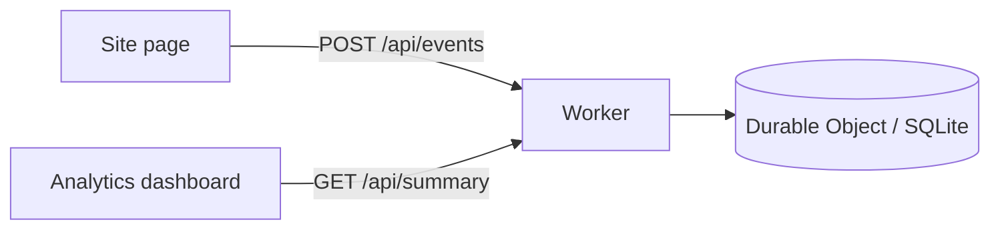

# Website analytics

GitHub Pages serves the site; the browser sends page views to a Cloudflare
Worker backed by one SQLite Durable Object. Public summaries appear at
`/analytics/` and `/zh/analytics/`.

The service lives at `https://analytics.xxxxyu.com`: `POST /api/events` accepts
visits, `GET /api/summary?days=30` returns aggregates (also supporting 90 days),
and `GET /` redirects to the website's analytics dashboard. Old API paths are
not supported; the `workers.dev` and preview URLs are disabled.



## Configuration

| Resource | Source of truth |
| --- | --- |
| Public endpoint | `extra.analytics_endpoint` in `config.toml` |
| Worker, account, origins and storage binding | `analytics-worker/wrangler.toml` |
| Custom domain binding | Cloudflare dashboard > Worker > Domains |
| Persistent object | `site-v1` in `analytics-worker/src/index.js` |
| Deployment credential | Repository secret `CLOUDFLARE_API_TOKEN` |

Keep the Worker, class, namespace and object identity stable to preserve history.
The current account token is `xxxxyu.github.io-github-actions`, with Editor on
`xiangyu-site-analytics` and Account Settings Read. Rotate it in Cloudflare's
**Manage account > Account API tokens** and replace the GitHub secret. Runtime
collection uses the storage binding; the token is only used for deployment.
See [Workers permissions](https://developers.cloudflare.com/workers/authorization/workers/).

Bind `analytics.xxxxyu.com` to the existing Worker for Production only in the
dashboard. Cloudflare manages its DNS record and certificate. Wrangler omits
`route`/`routes` so CI preserves this binding instead of rewriting it; the
deployment token needs no zone-management permission. Domain changes are an
owner operation requiring Workers Routes Write for the `xxxxyu.com` zone.
The website's origin remains `https://xxxxyu.github.io` in the CORS allowlist.

## Development

Run `./serve.sh` or `.\serve.ps1` for the site. Loopback previews use
`static/js/analytics-demo.mjs`; the 90-day sample extends the 30-day data and map.
To query a local collector, use Node.js 22.13+:

```sh
npm --prefix analytics-worker ci
npm --prefix analytics-worker run dev
```

Open `http://127.0.0.1:1111/analytics/?source=local`. Wrangler stores development
data in its ignored `.wrangler/` directory. The tracker excludes loopback hosts
and analytics pages, so viewing either preview does not create visits.

The UI is in `templates/analytics.html`, `static/js/analytics.js` and
`sass/_analytics.scss`; labels are in `data/analytics.toml`. The tracker is the
separate `static/js/analytics-track.js`. Summaries and map data are cached in
sessionStorage. Returning to the page refreshes summaries older than 60 seconds;
there is no background polling. The icon beside the update time refreshes on
demand. Refresh requests use `GET /api/summary?days=30&refresh=1` to bypass cached
results, update the same edge cache entry and return a `no-store` response.
Repeated focus events are coalesced and automatic retries are at least 60 seconds
apart. Requests time out after 10 seconds; failures preserve and label previous
results, and the refresh icon offers retry. Map loading does not block statistics.
Animations respect reduced motion.

## Verification

```sh
node --test tests/js/*.test.cjs
npm --prefix analytics-worker test
npm --prefix analytics-worker run test:integration
npm --prefix analytics-worker run check
```

Unit tests use Node's SQLite without npm dependencies. Integration tests use
Wrangler's installed test harness and production configuration with isolated
local storage. They cover concurrent delivery, duplicate events, object eviction
and the deployment check command. No Cloudflare login is needed. The bundle
check builds without publishing; website checks are listed in the README.

## Deployment and troubleshooting

| Workflow | Checks | Production trigger |
| --- | --- | --- |
| `deploy.yml` | Website tests and build | Push to `main`, daily Scholar refresh, manual run on `main` |
| `analytics.yml` | Collector tests and bundle | Push to `main` touching `analytics-worker/**` or its workflow; manual run on `main` |

Both workflows validate pull requests without deploying. Builds use a fixed
source revision, pinned Actions and locked dependencies. Write permissions are
limited to Scholar updates and Pages publishing; only the Worker deployment
step receives the Cloudflare token. Production runs are serialized. Publish
backend changes before frontend code that requires them.

Use **Analytics collector > Run workflow > main** to retry independently of
Pages. Actions Summary records the commit, deployment, verification and endpoint.
The read-only check retries across the previous version's 60-second cache window
and validates both 30/90-day responses,
CORS and `X-Analytics-Revision`. Each Worker version has its own edge cache key.
To repeat it locally, optionally appending an expected commit SHA:

```sh
npm --prefix analytics-worker run smoke -- https://analytics.xxxxyu.com
```

`ANALYTICS_SITE_ORIGIN` can override the production CORS origin for local checks.
For failures, inspect the Actions log and Cloudflare's `analytics-error` entries:
they record operation, exception type, version ID and commit tag, without event
payloads or exception messages. Invocation logs are disabled and query strings
redacted. Owner dashboard access or local Wrangler OAuth supports inspection.

If the site loads but statistics do not, check whether the browser can reach the
custom domain without a proxy. Check DNS, TLS and a read-only summary request
from the affected network; CI only tests the runner's route. The custom domain
avoids the default `workers.dev` hostname's reachability problem, but still
needs verification on the networks readers use.

## Measurement and retention

- One event per page load; event UUIDs prevent duplicate delivery. A random
  first-party browser ID lasts 365 days without renewal; its SHA-256 hash
  deduplicates visitors across the selected period. Clearing storage or changing
  browsers creates a new visitor.
- Collection respects DNT, GPC and saved exclusion preferences. The backend
  validates origins, event IDs and paths, and filters common bot user agents.
- Stored fields are pathname, referring hostname, country, city and rounded 1°
  coordinates. Query strings, fragments, raw IPs and raw visitor IDs are omitted.
  IP-derived geography is approximate; missing locations remain unknown.
- Days use UTC. Events last 400 days and visitor hashes expire after 366 inactive
  days. Lifetime counters survive cleanup. The first accepted event each UTC
  day performs cleanup in the same transaction as event and counter updates.
- Referring domains carry across internal navigation in a tab until 30 minutes
  idle. Public queries aggregate events; the edge cache lasts 60 seconds per
  data center. Workers Free quotas include requests, SQL reads/writes and storage;
  monitor all three. See [Durable Objects pricing](https://developers.cloudflare.com/durable-objects/platform/pricing/).
